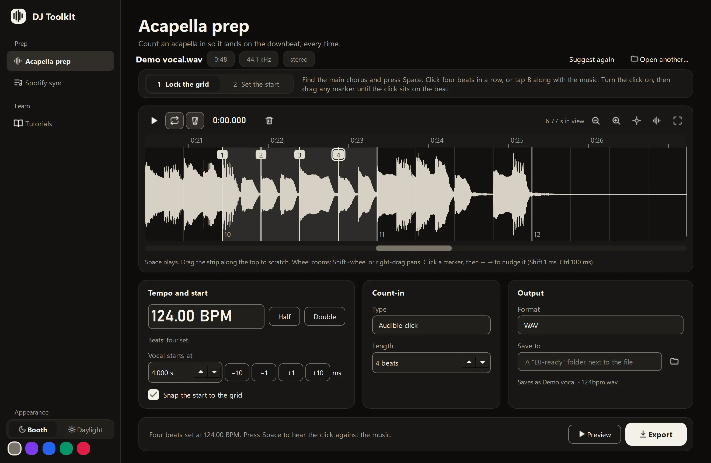

<p align="center">
  
</p>

# DJ Toolkit

Prep tools for working DJs. Free, open source, for Windows.

- **Acapella prep.** Lock the beat grid on four beats at the chorus, mark where the vocal comes in, and export it
  with a count-in. It lands on the downbeat, first time.
- **Spotify sync.** Each music folder becomes a Spotify playlist. You see every change before anything changes.
- **Tutorials.** Short, opinionated prep guides you can question, anonymously.

Two looks: **Booth** for dark rooms and late-night prep, **Daylight** for a laptop in the sun.
See it, and try the four-beat lock, on the [website](https://tomgreef.github.io/on-the-one/).

> **Early days.** It's tested with generated audio and about 160 automated tests, but not yet with many real
> acapellas or a live Spotify account. Try it and [tell us what felt off](CONTRIBUTING.md#ways-to-help).

## Run it

You need Windows 10 or 11 and [Python 3.12](https://www.python.org/downloads/).

```bat
git clone https://github.com/tomgreef/on-the-one.git
cd on-the-one
py -3.12 -m venv .venv
.venv\Scripts\pip install -r requirements.txt
run.bat
```

Your settings and your Spotify login stay on your computer, in `%APPDATA%\DJToolkit`. Exports are saved as new
files, and your music files are never changed. How to use it: [docs/user-guide.md](docs/user-guide.md).

## Help build it

DJs, designers, writers and developers are all welcome, and AI-assisted work is too.

| I want to | Read |
|---|---|
| Report a bug, share DJ feedback or make a first change | [CONTRIBUTING.md](CONTRIBUTING.md) |
| Get it running for development | [docs/getting-started.md](docs/getting-started.md) |
| Understand how it fits together | [docs/architecture.md](docs/architecture.md) |
| Work with an AI coding agent | [docs/vibe-coding.md](docs/vibe-coding.md) (agents read [AGENTS.md](AGENTS.md)) |
| Know who it's for and how it talks | [docs/ux/](docs/ux/README.md) |
| Find something to build | [docs/roadmap.md](docs/roadmap.md) |

## Licence

[MIT](LICENSE). DJ Toolkit is an independent project, not affiliated with Spotify or AlphaTheta (rekordbox).
